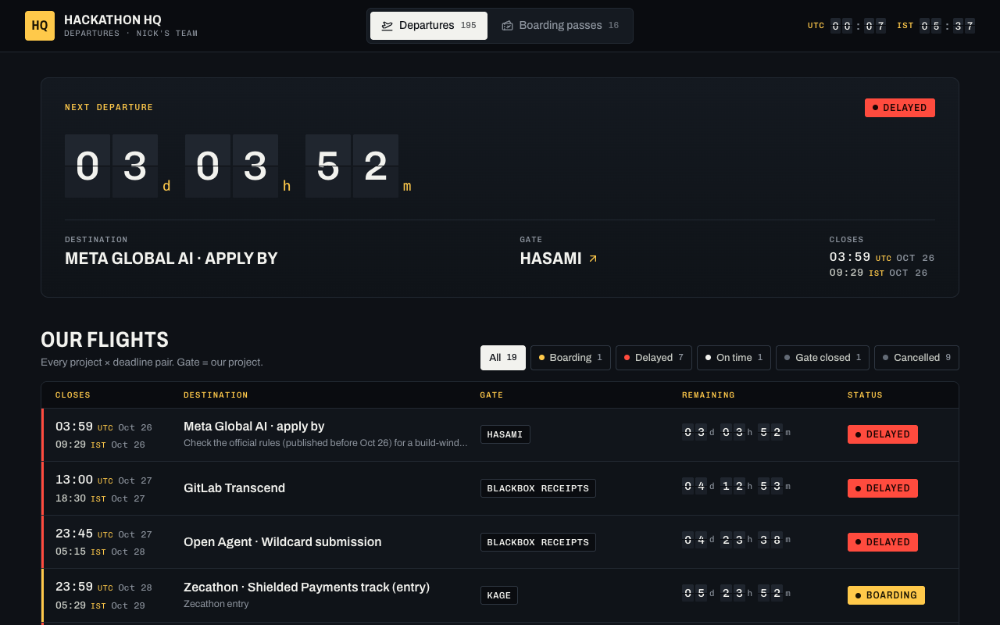
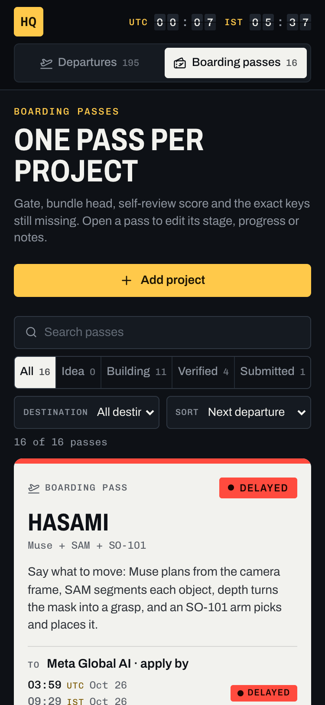

# Hackathon HQ

**An airport departures board for Nick's hackathon team: every deadline we're flying to, counting down in split flaps, with one boarding pass per project.**

Live: [nickthelegend.github.io/hackathon-hq](https://nickthelegend.github.io/hackathon-hq/), deployed from `main` by GitHub Pages once CI passes.





React, Vite, TypeScript and Tailwind, no backend. The seed files are the source of truth; this browser's local storage keeps only what you change.

## What's on the board

**Departures** (the default view, `#hackathons`)

- **Next departure**: the soonest open, dated deadline that one of our projects is aimed at, as a split-flap `dd hh mm` countdown, with its destination, gate (our project) and closing time in UTC and IST.
- **Our flights**: every project × deadline pair. Each row has a status: Boarding (aimed here, 7 days or less), Delayed (the project is BLOCKED on keys or accounts), On time (more than 7 days), Gate closed, Departed (submitted) or Cancelled (not entering: a portfolio piece, or one entry per team). The status buttons filter the list and show their counts; "How statuses are set" explains each rule.
- **All departures**: all 195 seeded hackathons. Search, track, format, source, idea and stage filters; sort by Closes soonest (the default), Closes latest or Judge score. Closed events are hidden until **Show closed** (the line says how many of the matching rows are hidden), and the list shows 30 rows at a time.
- **Flight drawer** (click a destination): prize, dates, the official https link, the gates aimed at it, board stage, judge score, a six-step build checklist and team notes.
- **Add hackathon** adds a custom event (https link required); it opens in its drawer and its row stays on screen even if its deadline has passed.

**Boarding passes** (`#projects`)

- One pass per project (16 in the seed): destinations with countdowns, judge score and latest self-review (a "Scores disagree" note appears when they are 2 or more apart), progress, stage, the missing keys from the BLOCKED clause of its next step, bundle and head commit, and the repository link.
- Filter by stage or destination, search, and sort by Next departure, Judge score or Progress.
- **Pass drawer**: stage, judge score, progress, next step, GitHub repo (https only) and notes.

Both boards have **Reset to seed** at the foot of the board; it asks first and names what you would lose.

## Run locally

```sh
npm install
npm run dev
```

`npm run build` type-checks and produces the production bundle. `npm run lint` runs ESLint and fails on any warning.

### Browser E2E (`e2e/`)

Playwright in the installed Google Chrome, desktop 1280×800 and mobile 375×812, with video and traces, against the production build served by `vite preview` on 127.0.0.1:4180:

```sh
cd e2e && npm install
npm run stack        # npm run build, then vite preview; PID in e2e/.run/pids
npm run test:e2e     # 32 tests x 2 viewports = 64 (also: npm run test:e2e from the repo root)
npm run stack:stop   # kills that PID
```

Expected values come from the seed files (`src/data/hackathons.json`, `src/data/projects.ts`) and the real clock, not from the app's own code. Every test fails on a console error or a failed same-origin request. `PW_CHANNEL` picks another browser channel. See [TESTING.md](TESTING.md) for what each test covers.

## CI and deployment

`.github/workflows/ci.yml` runs `npm ci`, lint and the E2E suite (in the runner's Google Chrome) on pull requests and branch pushes. On a push to `main`, `.github/workflows/pages.yml` runs the same job first and deploys `dist/` to [GitHub Pages](https://nickthelegend.github.io/hackathon-hq/) only if it passes. Set the repository's Pages source to **GitHub Actions** to enable deployment.

## Saved state

Nothing is sent anywhere. Local storage holds only your changes:

- Departures (`hackathon-hq-board-v3`): `{ format: 2, edits, custom }`. `edits` keeps, per card, a stage or score once you change it in the drawer (and only while it differs from the seed), notes and checklist ticks; `custom` holds hackathons you added. Every other field comes from the current seed, so seed updates reach browsers that visited before. A board saved by an older build keeps its notes, ticks, custom cards and stage changes, and takes the current seed score.
- Boarding passes (`hackathon-hq-projects-v1`): stage, progress, score, next step, repo, notes and custom projects. A project whose seed `seedVersion` is newer than the saved board's version takes the seed's stage, progress, score and next step again.
- Open tabs follow each other's saves. Everything read back is type-checked; malformed entries are repaired or dropped, and links that aren't `https://` are never rendered. If the page still can't render, it shows "The board could not be shown" with a button that clears both keys.

## Seed data

`data-import/hacklist.json` is the only seed source. `src/data/hackathons.json` contains one mapped record for each of its 195 deduplicated entries. Keep the source fields current when regenerating the seed.

Each object follows this schema:

| Field | Type | Meaning |
| --- | --- | --- |
| `id` | string | Stable, unique ID generated from the title. |
| `name` | string | Imported `title`. |
| `organizer` | string | Organizer name. |
| `track` | `web3`, `ai`, or `both` | Imported `category`, normalized to lowercase. |
| `prize` | string | Imported prize text; an empty value becomes `TBA`. |
| `startDate` | `YYYY-MM-DD` or `null` | Published opening/start date. |
| `deadline` | `YYYY-MM-DD` or `null` | Published end/submission date. |
| `rolling` | boolean | True when no fixed deadline is listed. |
| `format` | `online`, `in-person`, or `hybrid` | Normalized from the imported format. |
| `location` | string or `null` | Published event location. |
| `country` | string or `null` | Published country. |
| `url` | string | Event page URL. |
| `source` | string | Original source label; the Source filter groups `hacklist.io` and `hackathons.fun`. |
| `description` | string or `null` | Imported event description. |
| `free` | boolean or `null` | Imported entry fee flag. |
| `judgeScore` | number from 0 to 10 or `null` | Imported team score, shown as each row's Score; editable in the flight drawer. |
| `judgeIdea` | string or `null` | Imported idea association, used by the Idea filter and shown in the flight drawer. |
| `status` | `discovered` | Board stage. Imported `Backlog` entries map to the Discovered stage; the Stage filter and the drawer's Board stage select use it. |

`notes` and `checklist` are board-only fields stored in local storage. Dates are ISO calendar dates; date-only deadlines close at 23:59:59 UTC. Null deadlines show `TBA` and rolling events show `Rolling`.

## Boarding passes seed

The passes seed lives in `src/data/projects.ts`; each project has a `name`, one-line `pitch`, `targets`, nullable `judgeScore` (plus an optional `scoreNote`), `status` (Idea → Building → Verified → Submitted), `progress` (0–100), `repo`, `nextStep`, an optional `flag` such as `Parked`, and an optional `seedVersion` (see Saved state).

A target with a `hackathonId` links to that hackathon and uses its deadline for the countdown. A target for an event that isn't on the departures board yet sets `hackathonId: null` and its own `deadline`. A flight drawer lists the passes aimed at that hackathon as its gates.

## Current seed

The seed contains exactly 195 entries from the final `data-import/hacklist.json` list.

## License

MIT, see [LICENSE](LICENSE).
